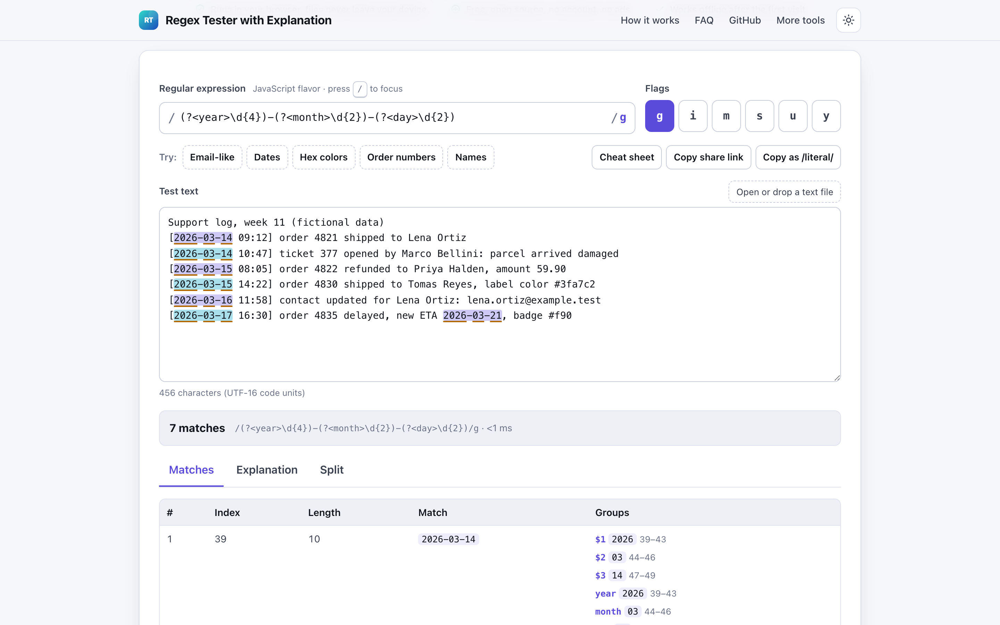
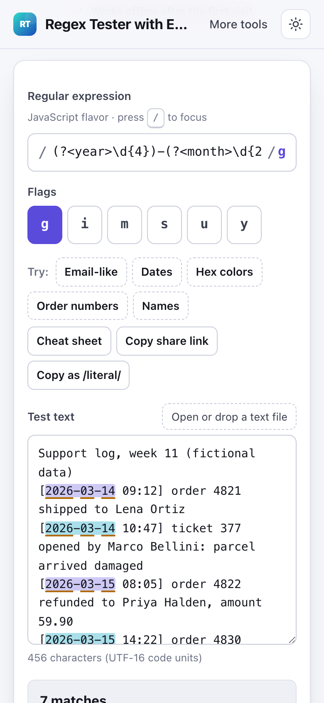

# Regex Tester with Explanation

> Test regular expressions live with highlighted matches and groups in your browser, no account.

**🌐 Use it now: [turhe123.github.io/regex-tester-local](https://turhe123.github.io/regex-tester-local/)** · free · open source · runs in your browser · works offline


## Why

Regex Tester with Explanation is a free, open-source alternative to regex101, which needs an account to save, sends patterns to its server, has a heavy and cluttered interface, and shows ads on mirror sites. Here your text never leaves the device, there is no account, no ads and no limits, it works offline, and you can install it as an app.

## Screenshots

<p align="center"></p>

<p align="center"><em>Regex Tester with Explanation in the browser, light theme</em></p>

<p align="center"></p>

<p align="center"><em>Regex Tester with Explanation on a phone</em></p>

## Features

- Live matching as you type, using the browser's built-in JavaScript (ECMAScript) RegExp engine. The page says so clearly.
- Flag toggles for `g`, `i`, `m`, `s`, `u` and `y`, with a tooltip for each.
- Test text area with a highlight layer: matches in alternating colors, capture groups marked inside each match, empty matches shown as a marker. Highlighting is HTML-escaped and counted in UTF-16 code units.
- Match list with index, length, full text, numbered groups and named groups (with group positions where the `d` flag is supported).
- Replace field with live output supporting `$1`, `$<name>`, `$&`, `` $` ``, `$'` and `$$`.
- Split preview showing the result of `text.split(/pattern/)`, including capture groups.
- Plain-language explainer built from a small hand-written pattern parser: classes, quantifiers, anchors, groups, lookarounds, alternation and escapes, plus a description of each active flag.
- Cheat sheet drawer (bottom sheet on phones); click a token to insert it into the pattern or replacement.
- Ready patterns with one click: email-like, dates, hex colors, order numbers and names.
- Catastrophic backtracking protection: matching runs in a Web Worker that is terminated after about one second, with a warning. The page stays responsive.
- Invalid patterns show the engine's error message under the field instead of crashing, with a hint when lookbehind is not supported by the browser.
- Share link that carries the pattern, flags and replacement in the URL `#` fragment, which browsers never send to a server.
- Keyboard: `/` focuses the pattern, Ctrl or Cmd + Enter copies the pattern as a JavaScript `/literal/`.
- Export: download `replaced.txt`, copy the replaced text, or download `matches.csv`.
- Open or drag in a text file instead of pasting.
- Light and dark themes; layout works at 390 px wide.

**Input and output formats**

- Input: pattern and flags typed in; test text pasted or loaded from plain text files (`.txt`, `.log`, `.csv`, `.tsv`, `.json`, `.md`, `.xml`, `.html`, `.yaml`, `.srt`, `.vtt`, `.js`, `.css`, `.ini`, `.conf` and similar).
- Output: highlighted text, match table, explanation, split list, replaced text (`replaced.txt`), match table (`matches.csv`), `/literal/` and share link.

**Limits**

- JavaScript flavor only; PCRE-only features (possessive quantifiers, atomic groups, recursion, `\A`, `\Z`) are not supported.
- Matching is stopped after about 1 second.
- Files over 20 MB are rejected; non-text files are skipped with an error message.
- Only the first 2,000 matches are highlighted, the match list shows the first 500, the split list the first 300, and the replaced-text preview is cut at 100,000 characters (the download has everything). Long texts (over 300,000 characters) show a note about the cap.
- Lookbehind is not available in some older Safari versions.
- CSV export contains the matches that were collected (up to the highlight cap).

## How to use

1. Type a JavaScript regular expression in the pattern field and toggle the flags you need, or start from a ready pattern or the cheat sheet.
2. Paste your test text (or open a text file). Matches highlight as you type.
3. Read the Matches tab for indexes and groups, the Explanation tab for what each token means, and the Split tab for the split result.
4. Enter a replacement such as `Order #$1` to see the replaced text, then copy or download it.
5. Copy the pattern as a `/literal/`, or copy a share link to send the pattern to someone.

## Privacy

- Nothing is uploaded. Your pattern and text are matched by your own browser and stay in memory on your device.
- No cookies.
- Page views are counted anonymously with [GoatCounter](https://www.goatcounter.com/) (cookieless, open source).
- Works offline through a service worker after the first visit.

## Run it locally

```sh
git clone https://github.com/turhe123/regex-tester-local
cd regex-tester-local
python3 -m http.server 4173
```

Then open http://127.0.0.1:4173/. There is no build step.

## Tests

```sh
npm i -D @playwright/test && npx playwright install chromium
npx playwright test
```

## Third-party code

None: browser APIs only.

## Built with AI

Regex Tester with Explanation was written by [Claude Code](https://claude.com/claude-code) inside an automated pipeline, from a plain-English spec. No code or assets from any commercial product were used; it is a clean-room implementation of a feature set, not a copy.

What that means in practice:

- The full source is in this repo under the MIT license. Read it before you trust it with your files.
- Everything runs in your browser. It makes no network requests except an anonymous, cookieless page-view count (GoatCounter); your files never leave the device.
- The page is tested headless in Chromium (Playwright) before every release, but it has had less human review than hand-written software. Bug reports and pull requests are welcome.

## Support ❤️

If this saved you time, you can support the project on [Ko-fi](https://ko-fi.com/leodavidai).

## More free web tools

Find more at [turhe123.github.io/web-tools](https://turhe123.github.io/web-tools/).

Also: [free, open-source Mac apps](https://turhe123.github.io/mac-apps/) built the same way, native Swift, no accounts, no telemetry.

## License

MIT © Or Davidai Bachar
